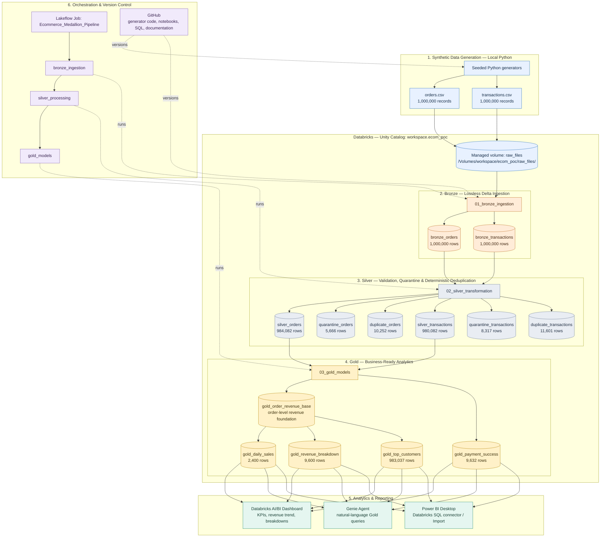

# E-Commerce Lakehouse | Databricks Medallion Architecture

An end-to-end data engineering project that transforms **2,000,000 synthetic e-commerce source records** into validated Delta Lake tables and reconciled analytics using **Databricks, Apache Spark, Unity Catalog, Databricks AI/BI, Genie Agent, Power BI, and Lakeflow Jobs**.

> **Assessment project:** Hands-on Data Engineering — Databricks Trial Workspace  
> **Repository:** [databricks-ecommerce-medallion](https://github.com/SujoySadhu/databricks-ecommerce-medallion)  
> **Environment:** Databricks 14-day trial, serverless notebook compute and a Serverless SQL warehouse. **Cloud region:** `ADD_REGION`.

## 1. Architecture



The pipeline follows **CSV sources → Unity Catalog Volume → Bronze → Silver → Gold → BI**. Lakeflow Jobs orchestrates the three processing stages in dependency order. Unity Catalog governs the schema, volumes and tables; Delta Lake stores the curated outputs.

| Layer | Purpose | Main objects |
|---|---|---|
| Landing | Preserve original synthetic CSVs | `/Volumes/workspace/ecom_poc/raw_files/` |
| Bronze | Lossless ingestion, source lineage | `bronze_orders`, `bronze_transactions` |
| Silver | Type casting, validation, deduplication, audit | `silver_orders`, `silver_transactions`, quarantine and duplicate-loser tables |
| Gold | Reusable business metrics | `gold_daily_sales`, `gold_revenue_breakdown`, `gold_payment_success`, `gold_top_customers` |
| Consumption | Reporting and natural-language analytics | Databricks AI/BI, Genie Agent, Power BI |

## 2. Dataset and data quality

A seeded Python generator creates **1,000,000 orders** and **1,000,000 transactions** (excluding CSV headers). The data is fully synthetic. Dirty-data reports record the injected counts and percentages for anomalies including missing identifiers, invalid numeric values, negative quantities or amounts, malformed/future timestamps, unsupported currency, inconsistent status, duplicates and orphan order references. The fraction of dirty records is controlled so validation is meaningful without overwhelming usable analytics.

Both files are uploaded unchanged to `/Volumes/workspace/ecom_poc/raw_files/`; the large CSV files are excluded from Git. Bronze keeps original fields as strings, with `_ingested_at`, `_source_file`, `_batch_id`, `_row_hash` and stable source-row identifiers to support auditing and repeatable loads. Malformed values remain in Bronze rather than being silently discarded.

**Silver processing order:** safely parse types → validate mandatory fields and business rules → quarantine invalid records with rejection reasons → deterministically select one valid row per business key → record duplicate losers. Invalid casts produce nulls that fail the relevant validation rule. Duplicate keys and exact duplicate rows are distinguished. Every Bronze row has exactly one outcome.

### Verified reconciliation

| Dataset | Bronze | Accepted Silver | Quarantined | Duplicate losers | Reconciled |
|---|---:|---:|---:|---:|---|
| Orders | 1,000,000 | 984,082 | 5,666 | 10,252 | Yes |
| Transactions | 1,000,000 | 980,082 | 8,317 | 11,601 | Yes |

For each dataset, **Bronze = Silver + Quarantine + Duplicate losers**, with no missing, extra or multiply classified source rows. Bronze source-count and rerun/idempotency checks were also validated in the notebooks. See the versioned notebooks and dirty-data reports for the rule breakdown and executable assertions.

## 3. Gold data products and metric definitions

| Dataset | Grain / unique grouping | Verified rows | Use |
|---|---|---:|---|
| `gold_daily_sales` | `sales_date`, `currency` | 2,400 | Revenue, order counts, cancellation rates |
| `gold_revenue_breakdown` | `sales_date`, `category`, `country`, `currency` | 9,600 | Category and geographic revenue |
| `gold_payment_success` | `txn_date`, `payment_method`, `currency` | 9,632 | Weighted payment-success rates |
| `gold_top_customers` | `sales_date`, `customer_id`, `currency` | 983,037 | Customer spending and ranking |

**Revenue policy:** `total_revenue` is **modeled collected-payment revenue**, not formal accounting revenue. It is based on successful payments associated with **COMPLETED** orders, capped at each order's value to prevent overcounting. Non-completed orders do not contribute; failed/pending/refunded transactions are not counted as positive collected revenue. Partial payments can contribute up to the order cap; repeat successful payments do not increase revenue beyond that cap. Refunds are not modeled as a separate net-revenue adjustment. Do **not** add amounts across BDT, USD, INR and GBP without currency conversion.

- **Total revenue:** `SUM(total_revenue)` from Gold, within the selected currency and dates.
- **Cancellation rate:** `100 × SUM(cancelled_orders) / SUM(total_orders)` — **not** the average of daily percentages.
- **Payment success rate:** `100 × SUM(successful_transactions) / SUM(total_transactions)` — weighted by transaction count.
- **Top customers:** filter by date and currency, aggregate revenue by customer, then order by revenue descending and `customer_id` ascending to break ties.

Documented grain and key definitions prevent accidental double counting when combining datasets. Source order and transaction records are reconciled before Gold aggregation; joins must not multiply order value by the number of related payments.

## 4. Analytics and cross-tool verification

### Databricks AI/BI dashboard


Includes four KPI counters, daily revenue trend, category/country revenue breakdowns, payment-success comparisons, top customers, and shared currency/date filters. The dashboard uses Gold-only sources.

### Power BI report


Power BI Desktop connects through the Databricks SQL warehouse using **Import** mode and a shared date/currency filter model. DAX measures calculate total revenue, total orders, completed orders, cancellation rate and weighted payment success. Import provides fast local interaction over this fixed synthetic dataset; DirectQuery instead queries the remote warehouse and is more sensitive to warehouse availability and query latency.

### Independently verified example

For **USD, January 1–February 28, 2025**, Databricks SQL, the AI/BI dashboard and the Power BI report agreed on:

| Metric | Verified value |
|---|---:|
| Total modeled revenue | **USD 1,405,307.48** |
| Total orders | 24,113 |
| Completed orders | 6,033 |
| Cancellation rate | 24.95% |

```sql
SELECT
  ROUND(SUM(total_revenue), 2) AS revenue,
  SUM(total_orders) AS total_orders,
  SUM(completed_orders) AS completed_orders,
  ROUND(100.0 * SUM(cancelled_orders) / SUM(total_orders), 2) AS cancellation_rate_pct
FROM workspace.ecom_poc.gold_daily_sales
WHERE currency = 'USD'
  AND sales_date BETWEEN DATE '2025-01-01' AND DATE '2025-02-28';
```

### Genie Agent


A Genie Agent was configured over Gold data with instructions for revenue, currency separation, weighted rates, dates, and deterministic customer ranking. The question **“What was total modeled USD revenue from January 1 to February 28, 2025?”** returned **USD 1,405,307.48**, matching independent SQL. **Assessment follow-up:** two additional Genie question/SQL checks remain to be attached or completed; do not treat the single checked question as all three.

## 5. Orchestration


Lakeflow Jobs defines the dependency chain **`bronze_ingestion` → `silver_processing` → `gold_models`**, using serverless notebook tasks. By default, Silver runs after successful Bronze completion and Gold runs after successful Silver completion. Task retries and failure notifications are configurable; the failed-dependency rule prevents publishing potentially stale Gold outputs.

**Run evidence:** a run was launched, with Bronze successful and Silver running in the last recorded screenshot. **Replace this sentence after confirming all three tasks show `Succeeded` and documenting the actual retry/notification settings.** Schedules should remain disabled after any test run.

## 6. Reproduce the project

1. Use an eligible Databricks trial with Unity Catalog, serverless notebook compute and a SQL warehouse. This project used the existing writable `workspace` catalog because a separate catalog was not required.
2. Create `workspace.ecom_poc` and the managed volume `raw_files` using `notebooks/00_setup` or the equivalent setup SQL.
3. Run the seeded generator scripts in `generator/`; verify exactly one million data rows per CSV and review the dirty-data reports. Do not commit the generated CSV files.
4. Upload `orders.csv` and `transactions.csv` to `/Volumes/workspace/ecom_poc/raw_files/`.
5. Run the notebooks in order: `01_bronze_ingestion` → `02_silver_transformation` → `03_gold_models`. Run the associated validation and reconciliation checks before using the Gold tables.
6. Create or import the AI/BI dashboard and Power BI `.pbix` using Gold datasets; apply identical date/currency filters and compare with the SQL result above.
7. Configure and run the three-task Lakeflow Job, then capture its final run state.

The Git repository stores **generator code, notebooks and documentation**, rather than private credentials or bulky source extracts. Keep tokens, `.env` files, secrets, connection credentials, raw CSVs and any real customer data out of commits. Production access should use a least-privilege reporting principal with `USE CATALOG`, `USE SCHEMA` and `SELECT` on the required Gold tables only; these are **intended grants**, not a claim that a separate reporting user was provisioned in the trial.

## 7. Trial limitations and cleanup

This was built in an **actual Databricks trial workspace**, not Community Edition or Free Edition. Trial entitlements and workspace permissions may restrict catalog creation, user provisioning or sharing; record the actual region, access restrictions and dashboard link before submission. Prefer serverless compute for the ETL workload and a SQL warehouse for BI; avoid idle queries and unnecessary concurrent runs to conserve credits.

Before expiry, verify notebook/SQL exports and the Power BI file, push Git changes, stop or suspend idle warehouses when supported, disable any job schedules, and check remaining trial credits. No cloud credentials or sensitive data should appear in screenshots.

